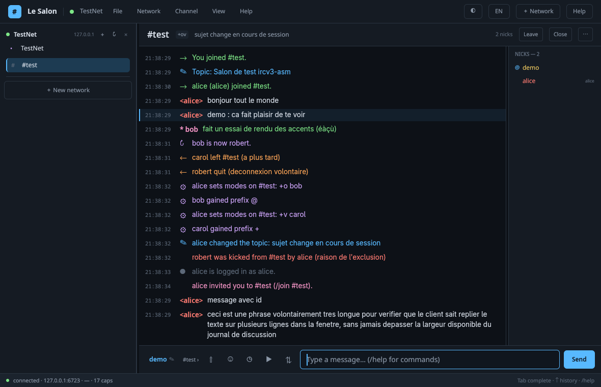
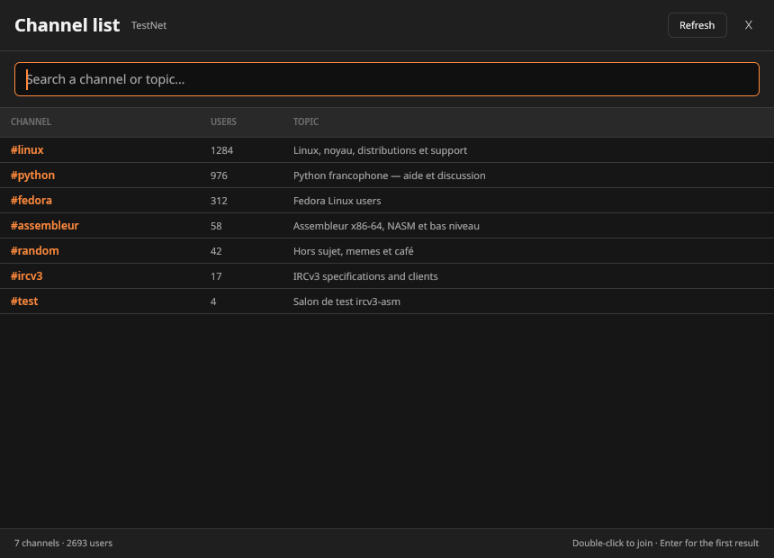

# Le Salon

### Client IRCv3 natif en Rust — interface GPU avec GPUI

[](https://www.rust-lang.org/)
[](https://gpui.rs/)
[](https://appimage.org/)
[](https://www.apple.com/macos/)
[](Cargo.toml)
[](#licence)

**🇫🇷 [Français](#français) · 🇬🇧 [English](#english) · 🌐 [Site web](https://mrthp.github.io/Le-Salon/)**

Le Salon est un client IRC moderne, natif et rapide : protocole IRCv3,
TLS, SASL, DCC, messages planifiés, emojis, thèmes, notifications et une
interface **entièrement bilingue français / anglais**. Testé sur **Fedora 45**
(Wayland et X11), avec un workflow CI prêt pour le build macOS universel.

Le Salon is a modern, native IRC client: IRCv3, TLS, SASL, DCC, scheduled
messages, emojis, themes, notifications and a **fully bilingual French /
English interface**. Tested on **Fedora 45** (Wayland and X11), with a
with a CI workflow ready for the universal macOS build.





---

## Français

### Un client IRCv3 pensé pour le bureau

Le Salon est la version **Rust + GPUI** du projet francophone ircv3-asm. L’interface est dessinée par **GPUI**, le framework
UI de Zed : rendu GPU, démarrage rapide, aucune dépendance à Electron ou à un
navigateur embarqué.

* **Français et anglais** : détection automatique de la langue du système au
  premier lancement (`fr*` → français, sinon anglais), bascule **FR / EN** en
  haut à droite, choix mémorisé.
* **Natif et léger** : AppImage Linux d’environ 10 Mo, binaire Rust unique.
* **Complet** : le cœur IRCv3 est dans `ircv3-core`, partagé par l’interface,
  les tests et l’outil console `probe`.

### Bilinguisme français / anglais

* interface **intégralement traduite** dans les deux langues ;
* détection automatique de la langue du système au premier lancement ;
* bascule **FR / EN** immédiate en haut à droite, choix mémorisé ;
* menus, formulaires, aide, notifications et messages locaux du protocole
  traduits aussi ;
* documentation bilingue dans ce README.

### Fonctionnalités

#### IRCv3 et réseau

| Fonction | Détail |
|---|---|
| Négociation CAP | `CAP LS 302`, `REQ`, `ACK`, `NAK`, `NEW`, `DEL`, `END` |
| Capacités | `message-tags`, `server-time`, `echo-message`, `multi-prefix`, `sasl`, `cap-notify`, `account-notify`, `account-tag`, `away-notify`, `batch`, `chathistory`, `extended-join`, `invite-notify`, `message-ids`, `monitor`, `setname`, `userhost-in-names`, `typing`, `chghost` |
| Authentification | **SASL PLAIN**, découpage 400 octets, échec non bloquant |
| TLS | **rustls**, SNI, vérification des certificats (option non vérifiée pour les tests) |
| Messages | tags IRCv3, `server-time`, `echo-message` sans doublon, CTCP `VERSION/PING/CLIENTINFO` |
| Salons | JOIN étendu, NAMES multi-préfixes, MODE, TOPIC, KICK, INVITE, AWAY, ACCOUNT, CHGHOST, SETNAME |
| Réseau | reconnexion avec backoff, keepalive, PING/PONG, latence, plusieurs réseaux en parallèle |

#### Interface

* arborescence **réseaux / serveur / salons / privés** avec compteurs de
  non-lus et mentions ;
* journal coloré, pseudos colorés, repli automatique du texte, historique par
  onglet et formatage mIRC (gras, italique, souligné, barré, monospace,
  couleurs 16/256 et hexadécimales) ;
* liste des pseudos avec préfixes `~&@%+`, états absents et comptes ;
* sujet, modes, population, état TLS, latence et capacités ;
* **pseudo cliquable** dans la barre de saisie : un clic ouvre la fenêtre
  « Changer de pseudo » et envoie `NICK` ;
* **panneaux redimensionnables** à la souris : arborescence ↔ journal ↔ liste
  des pseudos, largeurs mémorisées ;
* **fenêtre « Liste des salons »** séparée : recherche instantanée nom/sujet,
  nombre d’utilisateurs, tri par population, double-clic ou Entrée pour
  rejoindre ;
* **fenêtre « Préférences »** séparée (`Ctrl+P`) : thème, langue, notifications,
  toasts in-app, durée d’affichage et confirmation des uploads ;
* **toasts dans le coin** pendant 2 à 5 secondes pour les mentions et messages
  privés (ou tous les messages, au choix) ;
* **menus** Fichier / Réseau / Salon / Affichage / Aide et **clic droit** sur
  les pseudos, salons, réseaux et le journal ;
* **info-bulles** au survol des icônes, menus et boutons, en français ou en
  anglais ; le survol d’un pseudo affiche un mini-profil (rôle, compte, hôte,
  absence) ;
* **19 thèmes** : Nuit, Océan, Forêt, Améthyste, Sakura, Dracula, Nord,
  Gruvbox, Monokai, Solarized sombre/clair, Minuit, Carbone, Cyberpunk,
  Papier, Glacier, Rosé, Terminal, **Tux (Linux)** — bouton ◐, `Ctrl+T` ou
  fenêtre Préférences ;
* **plus de 300 emojis** avec recherche FR/EN et insertion au curseur ;
* notifications natives au mention/message privé quand la fenêtre est
  inactive, **toasts in-app configurables** (2/3/5 s) et désactivables ;
  **icône de barre système** sous Linux (StatusNotifierItem), déclinée en
  canapé comme l’icône de l’application ;
* fermeture par le **X** → reste dans le tray ; clic droit sur le tray →
  Afficher / Réduire / **Préférences** / Notifications / Déconnecter /
  **Quitter** ;
* indicateur « est en train d’écrire… », titre de fenêtre avec non-lus.

#### Au-delà du texte

* **DCC SEND** direct : offre CTCP, transfert TCP, progression, annulation,
  taille 64 bits, panneau dédié ;
* **upload litterbox** (public, 72 h, 50 Mo max) : sélecteur de fichier, lien
  posté automatiquement dans le salon ;
* **messages planifiés** : `+10m`, `18:30`, date complète, persistés dans
  `scheduled.json` ;
* **Jitsi** : ouverture de l’appel dans le navigateur et lien posté dans le
  salon ;
* **liens vidéo / audio / image** : détection automatique et bouton pour
  ouvrir le média dans le navigateur ou le lecteur système ;
* **À propos** : dialogue avec version, fonctions et licence.

> **Note importante** : GPUI n’intègre pas de moteur web. Jitsi et les vidéos
> s’ouvrent donc dans le navigateur/lecteur du système, pas dans une iframe
> embarquée. Le reste est natif.

### Téléchargement et lancement

Les binaires officiels sont publiés dans les
[releases GitHub](https://github.com/MrTHP/Le-Salon/releases). L’AppImage
Linux peut aussi être produite localement, à la racine de l’application :

```sh
chmod +x Le-Salon-1.7.0-x86_64.AppImage
./Le-Salon-1.7.0-x86_64.AppImage
```

Si Wayland pose problème, l’AppRun retente automatiquement sous XWayland.
Pour forcer X11 :

```sh
LE_SALON_X11=1 ./Le-Salon-1.7.0-x86_64.AppImage
```

L’AppImage embarque le binaire et les bibliothèques X11/xkb ; Vulkan, Wayland,
fontconfig, freetype et les pilotes graphiques viennent de l’hôte — c’est
nécessaire pour utiliser le GPU et les polices de la distribution.

### Compilation

Toutes les commandes ci-dessous se lancent depuis la **racine de
l’application** (le dossier qui contient ce README et `Cargo.toml`). Dans le
dépôt ircv3-asm, c’est le dossier `le-salon/`.

#### Fedora

```sh
sudo dnf install cargo rust gcc pkg-config \
  libxkbcommon-devel libxkbcommon-x11-devel \
  libxcb-devel libX11-devel fontconfig-devel freetype-devel \
  wayland-devel vulkan-loader-devel
cargo run --release -p le-salon
```

Le `build.rs` crée un lien local pour `libxkbcommon-x11.so` si seul
`libxkbcommon-x11.so.0` est installé : pas besoin de root pour compiler.

#### Debian / Ubuntu

```sh
sudo apt install build-essential pkg-config \
  libxkbcommon-dev libxkbcommon-x11-dev libxcb1-dev libxcb-xkb-dev \
  libx11-dev libwayland-dev libfontconfig1-dev libfreetype-dev libvulkan-dev
```

#### AppImage Linux

```sh
sh tools/build-appimage-le-salon.sh
# → Le-Salon-1.7.0-x86_64.AppImage
```

#### macOS

GPUI utilise Metal : la compilation doit se faire sur macOS avec Xcode.

```sh
rustup target add aarch64-apple-darwin x86_64-apple-darwin
sh tools/build-macos-app.sh
```

Le script produit `Le-Salon-1.7.0-macos-universal.zip` (arm64 + Intel) avec
une signature ad-hoc. macOS bloque les applications non notariées au premier
lancement :

```sh
unzip Le-Salon-1.7.0-macos-universal.zip
xattr -dr com.apple.quarantine "Le Salon.app"
open "Le Salon.app"
```

Le workflow `.github/workflows/build.yml` construit l’AppImage Linux et le
zip macOS sur des runners natifs.

### Utilisation

```sh
# formulaire de connexion
cargo run --release -p le-salon

# connexion immédiate
cargo run --release -p le-salon -- \
  --server irc.libera.chat --tls --nick monpseudo \
  --channel '#rust,#fedora'

# SASL PLAIN
cargo run --release -p le-salon -- \
  --server irc.libera.chat --tls --nick monpseudo \
  --sasl-user monpseudo --sasl-password 'secret' \
  --channel '#ircv3'
```

Options : `--server`, `--port`, `--nick`, `--channel`, `--tls`/`--no-tls`,
`--insecure`, `--sasl-user`, `--sasl-password`, `--x11`, `--version`,
`--help`.

### Commandes

`/join` `/part` `/cycle` `/nick` `/msg` `/query` `/me` `/notice` `/ctcp`
`/topic` `/names` `/whois` `/who` `/whowas` `/list` `/mode` `/op` `/deop`
`/voice` `/devoice` `/kick` `/ban` `/unban` `/invite` `/away` `/back`
`/monitor` `/raw` `/setname` `/ping` `/oper` `/wallops` `/clear` `/close`
`/reconnect` `/disconnect` `/quit` `/help`.

Fonctions locales :

| Commande | Effet |
|---|---|
| `/emoji` | ouvre la palette d’emojis |
| `/upload [fichier]` | téléverse sur litterbox et poste le lien |
| `/jitsi [salle]` | ouvre Jitsi et poste le lien |
| `/schedule +10m texte` | planifie un message |
| `/dcc send pseudo fichier` | envoie un fichier en direct |
| `/dcc cancel` | annule les transferts DCC |
| `/list [filtre]` | ouvre la fenêtre de recherche des salons |

### Raccourcis

| Raccourci | Action |
|---|---|
| `Ctrl+T` (`Cmd+T` sur macOS) | thèmes |
| `Ctrl+P` | préférences |
| `Ctrl+E` | emojis |
| `Ctrl+N` | nouveau réseau |
| `Ctrl+F` | focus sur la saisie |
| `Ctrl+L` | efface le tampon actif |
| `Ctrl+Q` (`Cmd+Q` sur macOS) | quitte Le Salon |
| `Alt+1..9` | change d’onglet |
| `Tab` | complète un pseudo ou un salon |
| `↑` / `↓` | historique de saisie |

### Configuration et sécurité

* Configuration : `~/.config/le-salon/config.toml`. Une configuration
  existante dans `~/.config/ircv3-gpui/` est migrée automatiquement au premier
  lancement pour ne pas perdre les réglages.
* Messages planifiés : `~/.config/le-salon/scheduled.json`.
* **Sécurité par défaut** : TLS et vérification du certificat activés.
  **SASL PLAIN exige TLS + certificat vérifié** ; une configuration SASL sans
  TLS est refusée avant toute connexion.
* Le mot de passe SASL n’est mémorisé **que si la case « Mémoriser le mot de
  passe SASL » est cochée**. Il est alors confié au trousseau système
  (Secret Service sous Linux, Keychain sous macOS, Credential Manager sous
  Windows), **indexé par réseau `(hôte, compte)`**, et n’apparaît pas dans le
  fichier de configuration. Si aucun trousseau n’est disponible, il est
  conservé en clair dans le fichier de configuration, avec des permissions
  **0600**. Le champ est effacé dès que l’hôte ou le compte change.
* `--no-tls`, `--insecure` et `--sasl-password` sont **strictement limités à
  la session** et ne modifient pas la configuration persistante. Préférer
  `LE_SALON_SASL_PASSWORD` à `--sasl-password` (visible dans `ps`).
* `config.toml` et `scheduled.json` sont écrits en **0600** dans un dossier
  **0700**. Détails et limites : [`SECURITY.md`](SECURITY.md).
* La fenêtre **Préférences** ne touche qu’aux réglages d’interface : elle
  n’affiche ni ne modifie les secrets de connexion. Les toasts affichent le
  contenu des messages et peuvent être désactivés.
* Le bouton X minimise Le Salon dans la barre système Linux ; pour quitter,
  utiliser le menu du tray ou **Fichier → Quitter**.

### Tests

```sh
cargo test --workspace
sh tools/test-e2e.sh
```

Les tests couvrent l’analyseur IRC/tags, le formatage mIRC, le modèle, les
commandes, CAP/SASL, un vrai socket TCP, le transfert DCC, le téléversement
(format), la planification et le scénario complet clair/TLS/SASL.

### Architecture

```text
.
├── crates/ircv3-core      protocole, modèle, TLS, SASL, DCC, upload, tests
└── crates/le-salon      application GPUI, thèmes, menus, i18n, tray
```

`ircv3-core` ne dépend d’aucune interface graphique : il est réutilisable par
un client console, des tests ou une autre interface.

### Limites connues

* GPUI n’a pas de webview : Jitsi et les vidéos s’ouvrent dans le navigateur
  ou le lecteur système.
* DCC est en **émission directe** uniquement ; le port doit être joignable et
  le CGNAT bloque le transfert direct.
* L’upload litterbox est **public pendant 72 h**, limité à 50 Mo.
* La barre système est spécifique à Linux ; macOS dispose des notifications.
* L’AppImage locale est construite sur Fedora 45 (glibc récente). Pour les
  distributions plus anciennes, utiliser le workflow GitHub Actions ou
  reconstruire dans un conteneur avec une glibc plus ancienne.
* Sans trousseau système joignable (session sans D-Bus, conteneur, machine
  distante), le mot de passe SASL mémorisé retombe sur le fichier 0600.

### Licence

MIT OR Apache-2.0. Voir [`LICENSE-MIT`](LICENSE-MIT) et [`LICENSE-APACHE`](LICENSE-APACHE).

---

## English

### A desktop IRCv3 client

Le Salon is the **Rust + GPUI** edition of the French ircv3-asm project. The UI is drawn by **GPUI**, Zed’s UI
framework: GPU rendering, fast startup, no Electron and no embedded browser.

* **French and English**: automatic system-language detection on first launch
  (`fr*` → French, otherwise English), **FR / EN** switch in the top bar,
  remembered across launches.
* **Native and lightweight**: Linux AppImage around 10 MB, a single Rust
  binary.
* **Complete**: the IRCv3 engine lives in `ircv3-core` and is shared by the
  UI, the tests and the console `probe` tool.

### French / English bilingual

* **fully translated** interface in both languages;
* automatic system-language detection on first launch;
* instant **FR / EN** switch in the top bar, remembered;
* menus, forms, help, notifications and local protocol messages are
  translated too;
* bilingual documentation in this README.

### Features

#### IRCv3 and networking

| Feature | Detail |
|---|---|
| CAP negotiation | `CAP LS 302`, `REQ`, `ACK`, `NAK`, `NEW`, `DEL`, `END` |
| Capabilities | `message-tags`, `server-time`, `echo-message`, `multi-prefix`, `sasl`, `cap-notify`, `account-notify`, `account-tag`, `away-notify`, `batch`, `chathistory`, `extended-join`, `invite-notify`, `message-ids`, `monitor`, `setname`, `userhost-in-names`, `typing`, `chghost` |
| Authentication | **SASL PLAIN**, 400-byte chunks, non-blocking failure |
| TLS | **rustls**, SNI, certificate verification (insecure option for test servers) |
| Messages | IRCv3 tags, `server-time`, duplicate-free `echo-message`, CTCP `VERSION/PING/CLIENTINFO` |
| Channels | extended JOIN, multi-prefix NAMES, MODE, TOPIC, KICK, INVITE, AWAY, ACCOUNT, CHGHOST, SETNAME |
| Networking | automatic reconnect with backoff, keepalive, PING/PONG, latency, multiple networks |

#### Interface

* **network / server / channel / query tree** with unread badges and
  highlight indicators;
* colored log, colored nicknames, text wrapping, per-tab history and mIRC
  formatting (bold, italic, underline, strikethrough, monospace, 16/256 and
  hex colors);
* nickname list with `~&@%+` prefixes, away state and accounts;
* topic, modes, user count, TLS state, latency and capabilities;
* **clickable nickname** in the input bar: opens a “Change nickname” dialog
  and sends `NICK`;
* **resizable panels**: tree ↔ chat log ↔ nickname list, widths persisted;
* **separate “Channel list” window**: instant name/topic search, user count,
  population sorting, double-click or Enter to join;
* **separate “Preferences” window** (`Ctrl+P`): theme, language,
  notifications, in-app toasts, display duration and upload confirmation;
* **corner toasts** for 2–5 seconds on mentions and private messages (or all
  messages, optionally);
* **menus** File / Network / Channel / View / Help and **right-click** menus
  on nicknames, channels, networks and the log;
* **tooltips** when hovering icons, menus and buttons, in French or English;
  hovering a nickname shows a mini profile (role, account, host, away);
* **19 themes**: Night, Ocean, Forest, Amethyst, Sakura, Dracula, Nord,
  Gruvbox, Monokai, Solarized Dark/Light, Midnight, Carbon, Cyberpunk, Paper,
  Glacier, Rosé, Terminal, **Tux (Linux)** — ◐ button, `Ctrl+T` or
  Preferences;
* **300+ emojis** with FR/EN search and insertion at the cursor;
* native notifications on mention/private message when the window is
  inactive, **configurable in-app toasts** (2/3/5 s) that can be disabled;
  **Linux system tray** (StatusNotifierItem), using a couch icon like the
  application icon;
* closing with **X** keeps Le Salon in the tray; right-click the tray →
  Show / Minimize / **Preferences** / Notifications / Disconnect / **Quit**;
* “is typing…” indicator and unread count in the window title.

#### Beyond plain text

* **DCC SEND** direct: CTCP offer, TCP transfer, progress, cancellation,
  64-bit size, dedicated panel;
* **litterbox upload** (public, 72 h, 50 MB max): file picker and automatic
  link posted to the channel;
* **scheduled messages**: `+10m`, `18:30`, full date, persisted in
  `scheduled.json`;
* **Jitsi**: opens the call in the browser and posts the link to the channel;
* **video / audio / image links**: automatic detection and a button to open
  the media in the system browser or player;
* **About** dialog with version, features and license.

> **Important note**: GPUI does not embed a web engine. Jitsi and videos
> therefore open in the system browser/player, not in an embedded iframe.
> Everything else is native.

### Download and run

Official binaries are published in the
[GitHub releases](https://github.com/MrTHP/Le-Salon/releases). The Linux
AppImage can also be produced locally at the application root:

```sh
chmod +x Le-Salon-1.7.0-x86_64.AppImage
./Le-Salon-1.7.0-x86_64.AppImage
```

If Wayland causes trouble, AppRun automatically retries under XWayland. To
force X11:

```sh
LE_SALON_X11=1 ./Le-Salon-1.7.0-x86_64.AppImage
```

The AppImage bundles the binary and the X11/xkb libraries; Vulkan, Wayland,
fontconfig, freetype and GPU drivers come from the host — this is required
for the GPU and system fonts.

### Build

All commands below are run from the **application root** (the folder that
contains this README and `Cargo.toml`). In the ircv3-asm repository, this is
the `le-salon/` folder.

#### Fedora

```sh
sudo dnf install cargo rust gcc pkg-config \
  libxkbcommon-devel libxkbcommon-x11-devel \
  libxcb-devel libX11-devel fontconfig-devel freetype-devel \
  wayland-devel vulkan-loader-devel
cargo run --release -p le-salon
```

The `build.rs` creates a local `libxkbcommon-x11.so` symlink when only
`libxkbcommon-x11.so.0` is installed, so no root is required to build.

#### Debian / Ubuntu

```sh
sudo apt install build-essential pkg-config \
  libxkbcommon-dev libxkbcommon-x11-dev libxcb1-dev libxcb-xkb-dev \
  libx11-dev libwayland-dev libfontconfig1-dev libfreetype-dev libvulkan-dev
```

#### Linux AppImage

```sh
sh tools/build-appimage-le-salon.sh
# → Le-Salon-1.7.0-x86_64.AppImage
```

#### macOS

GPUI uses Metal, so the build must run on macOS with Xcode installed.

```sh
rustup target add aarch64-apple-darwin x86_64-apple-darwin
sh tools/build-macos-app.sh
```

The script produces `Le-Salon-1.7.0-macos-universal.zip` (arm64 + Intel)
with an ad-hoc signature. macOS blocks non-notarized apps on first launch:

```sh
unzip Le-Salon-1.7.0-macos-universal.zip
xattr -dr com.apple.quarantine "Le Salon.app"
open "Le Salon.app"
```

The `.github/workflows/build.yml` workflow builds the Linux AppImage and the
macOS zip on native runners.

### Usage

```sh
# connection form
cargo run --release -p le-salon

# direct connection
cargo run --release -p le-salon -- \
  --server irc.libera.chat --tls --nick mynick \
  --channel '#rust,#fedora'

# SASL PLAIN
cargo run --release -p le-salon -- \
  --server irc.libera.chat --tls --nick mynick \
  --sasl-user mynick --sasl-password 'secret' \
  --channel '#ircv3'
```

Options: `--server`, `--port`, `--nick`, `--channel`, `--tls`/`--no-tls`,
`--insecure`, `--sasl-user`, `--sasl-password`, `--x11`, `--version`,
`--help`.

### Commands

`/join` `/part` `/cycle` `/nick` `/msg` `/query` `/me` `/notice` `/ctcp`
`/topic` `/names` `/whois` `/who` `/whowas` `/list` `/mode` `/op` `/deop`
`/voice` `/devoice` `/kick` `/ban` `/unban` `/invite` `/away` `/back`
`/monitor` `/raw` `/setname` `/ping` `/oper` `/wallops` `/clear` `/close`
`/reconnect` `/disconnect` `/quit` `/help`.

Local commands:

| Command | Effect |
|---|---|
| `/emoji` | open the emoji picker |
| `/upload [file]` | upload to litterbox and post the link |
| `/jitsi [room]` | open Jitsi and post the link |
| `/schedule +10m text` | schedule a message |
| `/dcc send nick file` | send a file directly |
| `/dcc cancel` | cancel DCC transfers |
| `/list [filter]` | open the channel search window |

### Shortcuts

| Shortcut | Action |
|---|---|
| `Ctrl+T` (`Cmd+T` on macOS) | themes |
| `Ctrl+P` | preferences |
| `Ctrl+E` | emojis |
| `Ctrl+N` | new network |
| `Ctrl+F` | focus input |
| `Ctrl+L` | clear active buffer |
| `Ctrl+Q` (`Cmd+Q` on macOS) | quit Le Salon |
| `Alt+1..9` | switch tab |
| `Tab` | complete nickname or channel |
| `↑` / `↓` | input history |

### Configuration and security

* Config: `~/.config/le-salon/config.toml`. An existing configuration in
  `~/.config/ircv3-gpui/` is migrated automatically on first launch so no
  settings are lost.
* Scheduled messages: `~/.config/le-salon/scheduled.json`.
* **Secure defaults**: TLS and certificate verification are enabled.
  **SASL PLAIN requires TLS + a verified certificate**; SASL without TLS is
  refused before any network connection.
* The SASL password is remembered **only if “Remember SASL password” is
  checked**. It is then kept in the system keyring (Secret Service on Linux,
  Keychain on macOS, Credential Manager on Windows), **indexed per network
  `(host, account)`**, and does not appear in the config file. If no keyring
  is available, it falls back to plain text in the config file with **0600**
  permissions. The field is cleared as soon as the host or account changes.
* `--no-tls`, `--insecure` and `--sasl-password` are **session-only** and do
  not modify the persistent configuration. Prefer
  `LE_SALON_SASL_PASSWORD` over `--sasl-password` (visible in `ps`).
* `config.toml` and `scheduled.json` are written as **0600** inside a
  **0700** directory. Details and limitations: [`SECURITY.md`](SECURITY.md).
* The **Preferences** window only changes interface settings: it never
  displays or modifies connection secrets. Toasts display message content and
  can be disabled.
* The X button minimizes Le Salon to the Linux tray; to quit, use the tray
  menu or **File → Quit**.

### Tests

```sh
cargo test --workspace
sh tools/test-e2e.sh
```

Tests cover the IRC parser/tags, mIRC formatting, the model, commands,
CAP/SASL, a real TCP socket, DCC transfer, upload (format), scheduling and
the full plain/TLS/SASL scenario.

### Architecture

```text
.
├── crates/ircv3-core      protocol, model, TLS, SASL, DCC, upload, tests
└── crates/le-salon      GPUI app, themes, menus, i18n, tray
```

`ircv3-core` has no GUI dependency: it can be reused by a console client,
tests or another interface.

### Known limitations

* GPUI has no webview: Jitsi and videos open in the system browser/player.
* DCC is **send-only direct**; the port must be reachable and CGNAT blocks
  direct transfers.
* Litterbox upload is **public for 72 h**, limited to 50 MB.
* The system tray is Linux-only; macOS has notifications.
* The local AppImage is built on Fedora 45 (recent glibc). For older
  distributions, use the GitHub Actions workflow or rebuild in a container
  with an older glibc.
* Without a reachable system keyring (no D-Bus session, container, remote
  machine), the remembered SASL password falls back to the 0600 file.

### License

MIT OR Apache-2.0. See [`LICENSE-MIT`](LICENSE-MIT) and [`LICENSE-APACHE`](LICENSE-APACHE).
